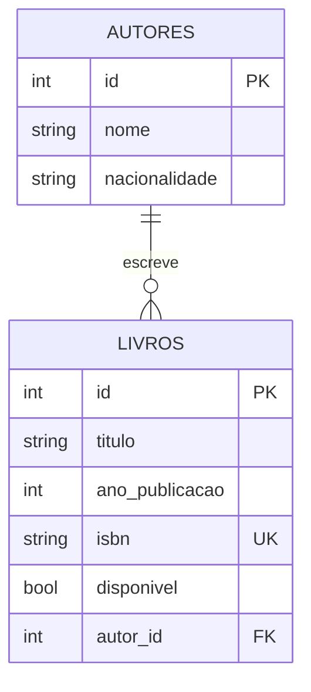

# API da Biblioteca

## Modelo de negócio
API para gerenciar o acervo de uma biblioteca, com autores e os livros que escreveram.

## Entidades e relacionamento



Um **Autor** possui vários **Livros** (1:N). Cada **Livro** pertence a um único Autor.

## Tecnologias
FastAPI, SQLAlchemy, Alembic, Pydantic, SQLite.

## Como rodar

```bash
git clone https://github.com/4drian0/biblioteca-api.git
cd biblioteca-api

python -m venv .venv
.venv\Scripts\activate           # Linux/Mac: source .venv/bin/activate

pip install -r requirements.txt
copy .env.example .env           # Linux/Mac: cp .env.example .env

alembic upgrade head             # cria o banco via migrações
uvicorn app.main:app
```

Swagger: http://127.0.0.1:8000/docs

## Endpoints

### Autores
| Método | Rota | Descrição | Status |
|---|---|---|---|
| POST | /autores/ | Cria autor | 201 |
| GET | /autores/ | Lista autores | 200 |
| GET | /autores/{id} | Busca autor (com livros) | 200 / 404 |
| PATCH | /autores/{id} | Atualiza autor | 200 / 404 |
| DELETE | /autores/{id} | Remove autor | 204 / 404 / 409 |

### Livros
| Método | Rota | Descrição | Status |
|---|---|---|---|
| POST | /livros/ | Cria livro (valida autor e ISBN) | 201 / 404 / 409 |
| GET | /livros/ | Lista livros (filtros: autor_id, disponivel) | 200 |
| GET | /livros/{id} | Busca livro | 200 / 404 |
| PATCH | /livros/{id} | Atualiza livro | 200 / 404 / 409 |
| DELETE | /livros/{id} | Remove livro | 204 / 404 |

## Integrantes
- Nome 1
- Nome 2